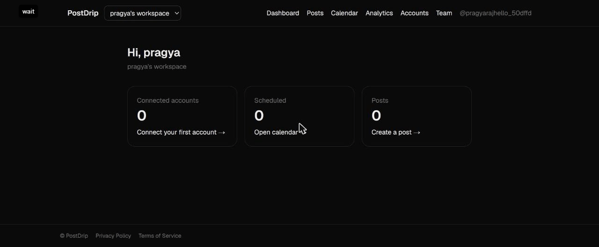

# PostDrip: social media management with AI

[](https://github.com/pragyaarajputt/ai-social-platform/actions/workflows/ci.yml)

Connect your social accounts (Instagram, Facebook Pages, LinkedIn profiles, X and Bluesky; Threads, YouTube and TikTok planned), write a post once with AI help, and publish or schedule it to every platform from one dashboard.

🔗 **Live demo:** [ai-social-platform-nine.vercel.app](https://ai-social-platform-nine.vercel.app)



**Status:** Phase 9. Connect Instagram accounts, **Facebook Pages**, **LinkedIn** personal profiles, **X** and **Bluesky** (long posts become threads), write once and publish to all of them, upload photos and videos, publish to one or more Instagram accounts (single image, carousel, Reel) **now or on a schedule**, plan posts on a calendar, and write with **AI**: captions in five tones (from an idea and/or the photos), hashtag suggestions, rewrites, and a workspace brand voice. **Analytics**: account reach, views, interactions and followers over time, per-post numbers, top posts (CSV export), and when followers are online.

> `docs/PRD.md` describes the original social-network idea and is out of date. The product is now a social media management tool.

## Tech stack

- **Frontend:** Next.js 16 (App Router, TypeScript, Tailwind CSS, ESLint)
- **Backend:** Node.js + Express 5 (TypeScript)
- **Database:** PostgreSQL 18 + Prisma ORM 7 (pg driver adapter)
- **Auth:** argon2id passwords, JWT access tokens (jose), rotating refresh tokens in an httpOnly cookie
- **Integrations:** Instagram API with Instagram Login and Facebook Pages API with Facebook Login for Business (Graph API v26.0), plain `fetch`, tokens encrypted with AES-256-GCM
- **Media:** Cloudinary (direct browser uploads; REST API with plain `fetch`)
- **Jobs:** a Postgres-backed queue (`post_targets` rows claimed with `FOR UPDATE SKIP LOCKED`), no Redis
- **AI:** Claude (Claude Opus 5 by default) through the official `@anthropic-ai/sdk`, with structured outputs, or Google Gemini (`AI_PROVIDER=gemini`)

## Structure

```
frontend/
  src/
    app/         pages: (auth)/ login, signup, forgot/reset password, verify email;
                 (protected)/ account, accounts, analytics, calendar, posts (list, new, [id], [id]/edit), settings/brand-voice, settings/workspace; auth/callback, invite/[token]
    components/  ui/ primitives, ai/ composer AI panel and brand voice, analytics/ page, charts, heatmap, auth/ forms and guards, accounts/, calendar/, posts/, workspace/
    lib/         API client, session, workspaces, posts + uploads, AI, analytics, dates, Instagram rules, form schemas
backend/
  prisma/
    schema.prisma  database schema
    migrations/    SQL migrations (committed)
  prisma.config.ts Prisma CLI config
  src/
    ai/          Claude and Gemini clients behind one provider interface, versioned prompts, pricing
    config/      environment, app config, Prisma client
    generated/   generated Prisma client (gitignored)
    integrations/ one adapter per social platform (instagram/, facebook/, linkedin/, x/, bluesky/; textThread.ts splits long text for X and Bluesky), shared interface in types.ts, Meta HTTP/errors in meta.ts
    jobs/        publish queue (claim, publish, retry) and analytics collection
    storage/     Cloudinary client
    controllers/ request handlers
    middleware/  express middleware (auth, validation, rate limits, errors)
    routes/      route definitions
    schemas/     zod request schemas
    services/    business logic
    types/       type augmentations
    utils/       helpers
    app.ts       express app setup
    server.ts    API entry point
    worker.ts    background jobs (publishing every 5 s; hourly token refresh, warnings, analytics), run separately
  tests/         API integration tests (vitest + supertest)
docs/
  PRD.md         product requirements
```

## Getting started

Requires Node.js 24+ and PostgreSQL 18.

### Database (one time)

Create an app user and database (as the `postgres` superuser):

```sql
CREATE ROLE social_app LOGIN PASSWORD 'your-password' CREATEDB;  -- CREATEDB is needed for Prisma's shadow database
CREATE DATABASE social_dev OWNER social_app;
CREATE DATABASE social_test OWNER social_app;                    -- used by npm test
```

### Run

```bash
# Backend: http://localhost:4000
cd backend
cp .env.example .env        # then set DATABASE_URL and JWT_ACCESS_SECRET
npm install                 # also generates the Prisma client
npm run db:migrate          # apply migrations
npm run dev

# Frontend: http://localhost:3000
cd frontend
cp .env.example .env.local  # API_URL: where Express runs
npm install
npm run dev
```

Open http://localhost:3000. The browser only ever talks to the frontend: `/api/v1/*` is forwarded to Express by a rewrite in `frontend/next.config.ts`, so the refresh cookie is first-party and no CORS is needed.

Check the API is running: `curl http://localhost:4000/health`. Check the database connection: `curl http://localhost:4000/ready`.

Without `SMTP_URL`, verification and password-reset emails are printed in the backend console.

## Auth API

All under `/api/v1/auth`. Responses that start a session return `{ user, accessToken, expiresIn }` and set a `refresh_token` cookie (httpOnly, 30 days, path `/api/v1/auth`). Send the access token as `Authorization: Bearer <token>`. It expires after 15 minutes; call `POST /refresh` for a new one.

| Endpoint | Auth | Purpose |
| --- | --- | --- |
| `POST /register` | — | `{ email, username, password, displayName }` |
| `POST /login` | — | `{ email, password }`. 5 failures per email + IP → 15 min lockout |
| `POST /refresh` | cookie | Rotates the refresh token. Reusing an old one revokes the whole session |
| `POST /logout` | cookie | Ends this session |
| `POST /logout-all` | bearer | Ends every session |
| `GET /me` | bearer | Current user |
| `POST /verify-email` | — | `{ token }` from the email link |
| `POST /resend-verification` | bearer | Max 3 per hour |
| `POST /forgot-password` | — | `{ email }`. Always returns 200 |
| `POST /reset-password` | — | `{ token, password }`. Signs out every session |
| `GET /google` | — | Starts Google sign-in, which also signs up new people (`?next=/invite/…` returns there afterwards). Needs `GOOGLE_*` env vars; without them, and on any failure, it redirects to `/login?error=<reason>` (`google_unavailable`, `google_cancelled`, `google_expired`, `google_email_taken`, `oauth_failed`) |

Errors always look like `{ "error": { "code": "...", "message": "...", "details": ... } }`.

### How the frontend keeps you signed in

- The access token is kept in memory only (never in localStorage). On page load the app calls `POST /refresh`, and the httpOnly cookie restores the session.
- It refreshes 60 seconds before the token expires, and retries once if a request gets `TOKEN_EXPIRED`.
- Only one refresh runs at a time, across all tabs (Web Locks API). This matters because the server treats a refresh token used twice as stolen and ends the session.
- Pages under `app/(protected)` redirect to `/login?next=...` when signed out. The API is the real security boundary: every protected endpoint checks the token.

### Client IPs behind the rewrite

Requests reach Express from the Next.js server, so set `TRUST_PROXY` in `backend/.env` (`loopback` locally) or every user shares one IP for rate limiting. In production, run Next.js behind a load balancer that sets `X-Forwarded-For` itself and trust only that hop: Next.js passes through an `X-Forwarded-For` header sent by the client, so trusting it directly would let clients choose their own IP.

## Workspaces and connected accounts

Everything belongs to a **workspace**, not a user. Each sign-up gets a personal workspace with the user as `OWNER`; users can create more (e.g. one per client), join others by invite, and switch between them in the header. Roles are `OWNER`, `ADMIN`, `EDITOR` and `VIEWER`; connecting or disconnecting accounts needs `ADMIN` or above.

| Endpoint | Auth | Purpose |
| --- | --- | --- |
| `GET /api/v1/workspaces` | bearer | My workspaces |
| `GET /api/v1/workspaces/:id/social-accounts` | bearer, VIEWER+ | Connected accounts (never includes tokens) and which platforms are configured |
| `POST /api/v1/workspaces/:id/social-accounts/:platform/connect` | bearer, ADMIN+ | Returns the platform's consent URL (`instagram`, `facebook`) |
| `GET /api/v1/workspaces/:id/social-accounts/:accountId/disconnect-impact` | bearer, ADMIN+ | Scheduled posts that use the account, and the next one's time |
| `DELETE /api/v1/workspaces/:id/social-accounts/:accountId` | bearer, ADMIN+ | Disconnect: deletes the tokens. Body `{ scheduledPosts: "cancel" | "keep" }` (default `cancel`: removes this account from its scheduled posts; other accounts in them still publish) |
| `GET /api/v1/integrations/:platform/callback` | — | The platform redirects here; we redirect to `/accounts?connected=…&count=…` or `?error=…` |
| `POST /api/v1/integrations/instagram/deauthorize` | Meta `signed_request` | User removed our app on Instagram |
| `POST /api/v1/integrations/instagram/data-deletion` | Meta `signed_request` | User asked Meta to delete their data |

**Tokens** are encrypted with AES-256-GCM and never sent to the browser. **The worker** (`npm run worker`) refreshes Instagram tokens every hour once they are 24 hours old and expire within 10 days; an account whose token can't be refreshed is marked `NEEDS_REAUTH` and shown as "Reconnect needed". Running several workers is safe: a Postgres advisory lock lets only one do each run.

### Team: roles and invites

| Action | Viewer | Editor | Admin | Owner |
| --- | :-: | :-: | :-: | :-: |
| See posts, calendar, analytics, accounts, members | ✅ | ✅ | ✅ | ✅ |
| Create, edit, schedule posts; upload media; use AI | | ✅ | ✅ | ✅ |
| Connect/disconnect accounts; brand voice; rename workspace | | | ✅ | ✅ |
| Invite (as Viewer, Editor or Admin); resend or revoke invites | | | ✅ | ✅ |
| Change roles or remove members | | | Editors and Viewers | Everyone |
| Transfer ownership, delete workspace (name + password) | | | | ✅ |

A workspace always has exactly one owner; ownership only changes through a transfer (the old owner becomes an admin). Nobody changes their own role, and admins can't change or remove other admins. Membership changes lock the workspace row, so concurrent changes can't produce two owners. Members see each other's names; only owners and admins see email addresses. The interface hides what a role can't do; the API enforces it.

**Invites** (`/settings/workspace`): an admin enters an email and role; the invitee gets a link `/invite/<token>` (admins can also copy it). The token is stored hashed, works once, and expires after 7 days. Only someone signed in with **the same, verified email** can accept; people without an account sign up from the invite page and come back to it. Inviting the same email again refreshes the pending invite (new link; the old one stops working). Limits: 20 invites per workspace per hour, one resend per invite per minute.

**Removing a member:** access ends immediately (membership is checked on every request). Their posts stay. Accounts they connected use tokens issued to *their* login, so by default those are disconnected too (their scheduled posts on those accounts are cancelled); account cards show "Connected by …". Warnings about scheduled posts go to the author while they're a member, otherwise to the owner and admins.

**Deleting a workspace** deletes its posts, media records, connected accounts and team; it's refused while posts are publishing, and you can't delete your only workspace.

| Endpoint | Role |
| --- | --- |
| `POST /workspaces` · `PATCH /workspaces/:id` `{name}` · `DELETE /workspaces/:id` `{confirmName, password}` | signed in · ADMIN+ · OWNER |
| `GET …/members` · `PATCH …/members/:userId` `{role}` · `DELETE …/members/:userId` `{disconnectAccounts}` | VIEWER+ · ADMIN+ · ADMIN+ |
| `POST …/members/me/leave` · `POST …/transfer-ownership` `{userId, confirmName, password}` | member · OWNER |
| `GET/POST …/invites` · `POST …/invites/:id/resend` · `DELETE …/invites/:id` | ADMIN+ |
| `GET /invites/:token` (preview, masked email) · `POST /invites/:token/accept` | public · signed in |

**Connection rules and safeguards**

- **One workspace per account:** a platform account can be active (`ACTIVE` or `NEEDS_REAUTH`) in one workspace at a time, enforced by a partial unique index (`social_accounts_one_active_workspace`). Connecting it elsewhere fails with `error=connected_elsewhere` (the other workspace isn't named); when some of the granted Facebook Pages are taken, the rest connect and the redirect says how many were skipped (`elsewhere=N`). Disconnected or revoked accounts can be connected anywhere.
- **Daily health check:** the worker makes one cheap call per account per day with its stored token (Instagram profile, Facebook Page). A rejected token or a lost permission or Page role marks the account `NEEDS_REAUTH` (audit `social_account.health_check_failed`), so the pre-flight check warns authors of posts due in the next 24 hours. Outages and rate limits never mark an account broken. The same call keeps names and pictures current; accounts show "Connection checked … ago".
- **PKCE:** adapters that set `usesPkce` get an S256 code challenge in the consent URL; the verifier stays on the server, encrypted, in the connect state and is deleted when used. X requires it; Instagram, Facebook and LinkedIn don't.

**Rotating the encryption key**

1. Generate a key: `node -e "console.log(require('crypto').randomBytes(32).toString('base64'))"`.
2. Replace `TOKEN_ENCRYPTION_KEY` with a list, new key first: `TOKEN_ENCRYPTION_KEYS=v2:<new key>,v1:<old key>`. Restart the API and the worker. New tokens use `v2` immediately; old ones stay readable.
3. The worker re-encrypts old tokens in batches each hour (never overwriting a token refreshed in the meantime). Check progress with `npm run tokens:key-status`.
4. When it shows nothing left on `v1`, remove `v1` from the list and restart.

The server refuses to start if the list is malformed, a key isn't 32 bytes, or a version appears twice.

### Setting up Instagram

1. **Instagram account:** it must be a professional account (Business or Creator). In the Instagram app: Settings → Account type and tools → Switch to professional account.
2. **Meta app:** at developers.facebook.com create an app (type Business), add the **Instagram** product, and choose **API setup with Instagram business login**. Copy the **Instagram app ID and secret**.
3. **Testers:** App roles → Roles → Instagram testers → add your account, then accept the invite in Instagram (Settings → Apps and websites → Tester invites). In development mode, only tester accounts can connect.
4. **Redirect URI:** add `https://<your-host>/api/v1/integrations/instagram/callback` under "Business login settings". Meta needs an HTTPS URL, so local development needs a tunnel with a fixed address.
5. **Deauthorize and data deletion:** set the callback URLs to `…/api/v1/integrations/instagram/deauthorize` and `…/data-deletion` (required for app review).
6. Put `INSTAGRAM_APP_ID`, `INSTAGRAM_APP_SECRET` and `INSTAGRAM_REDIRECT_URI` in `backend/.env` and restart the backend.

Serving accounts you don't own needs Meta **app review** (advanced access).

## Facebook Pages

Connect with **Connect Facebook Pages** on the Accounts page. Facebook's window lets you choose Pages; every chosen Page where you can create content becomes its own account. Page tokens (from a long-lived user token) don't expire; they stop working only if the app is removed, you lose your Page role, or you change your password, and then the Page shows "Reconnect".

**Setup** (`backend/.env`): `FACEBOOK_APP_ID`, `FACEBOOK_APP_SECRET` (App settings → Basic of your Meta app; not the Instagram app ID), `FACEBOOK_REDIRECT_URI` (`https://<host>/api/v1/integrations/facebook/callback`, HTTPS; also added under Facebook Login for Business → Settings). Optional `FACEBOOK_CONFIG_ID`: a login configuration (User access token) with `pages_show_list`, `pages_manage_posts`, `pages_read_engagement`, `read_insights`, `business_management`; without it these permissions are requested directly. People with a role on the app can use them right away; everyone else needs App Review. Deauthorize and data-deletion callbacks: `/api/v1/integrations/facebook/deauthorize` and `/data-deletion`.

| Post | Facebook | Instagram |
| --- | --- | --- |
| Text only | Text post | Not possible |
| 1 photo | Photo post | Single image |
| Several photos | Multi-photo post (up to 10) | Carousel |
| 1 video | **Reel** when vertical (≤ 0.6 width/height), 3–90 s and ≥ 540 px wide; otherwise a video post | Reel |
| Photos and videos mixed | Not possible | Carousel |

Each selected account is checked against its own platform's rules (Facebook text up to 63,206 characters, Instagram 2,200); per-account captions let the Facebook version be longer. Media is sent by URL (`file_url`), as for Instagram.

**Never posting twice:** each step's result is saved as it happens. Just before the call that creates the post, a marker is saved. If a retry finds the marker without a result, the worker looks for the post among the Page's recent posts (same text, created since the attempt started); if it isn't there, the post fails with "Couldn't confirm whether Facebook published this post" instead of risking a duplicate, and the user's Retry posts it. A clear error from Facebook clears the marker, so normal retries stay automatic. Reels finish only if Facebook hasn't started publishing them.

**Analytics:** Page insights metrics were cut back on 15 June 2026. Used: `post_media_view` / `post_total_media_view_unique` (views, reach), reactions, comments and shares per post; `page_media_view` / `page_total_media_view_unique` per day; `followers_count`. Not available for Pages: saves, follows/unfollows, and when followers are online.

## X (Twitter)

Connect with **Connect X** on the Accounts page. X uses OAuth 2.0 with **PKCE** (the app is a confidential client, so token calls also send its ID and secret). Scopes: `tweet.read tweet.write users.read media.write offline.access`.

**Setup** (`backend/.env`): `X_CLIENT_ID`, `X_CLIENT_SECRET`, `X_REDIRECT_URI` (`https://<host>/api/v1/integrations/x/callback`, also added as a callback URL in the X Developer Console, app type "Web App"). X bills API use per request (pay-per-use credits), so posting needs credits on the app; a 402 from X fails the post with X's message.

**Threads.** One post is 280 *weighted* characters: emoji, CJK and most non-Latin characters count 2, every URL counts 23 (`backend/src/integrations/x/text.ts`). Longer text is published as a thread of up to 25 posts, each replying to the one before:
- a line with only `---` starts a new post where the author wants it;
- anything still too long is split at a paragraph or sentence end (or between words), and each post gets a ` 1/3` counter;
- photos (up to 4) or one video go on the first post.

The composer shows the exact thread before publishing: the frontend runs a copy of the same splitting code (`frontend/src/lib/xThread.ts`).

**Never posting twice, even halfway through a thread:** each post's ID is saved as soon as X returns it, so after a rate limit the retry carries on with the next post instead of starting over. Just before each post is created a marker is saved; if a retry finds it without a result, the post fails with "Couldn't confirm whether X published post 2 of this thread" rather than risk a duplicate.

**Tokens.** Access lasts 2 hours and every refresh returns a new refresh token, invalidating the old one. The worker refreshes X tokens hourly, publishing renews a token that expires within 5 minutes first, and refreshes of one account are serialized with a Postgres advisory lock, so two refreshes at once can't both spend the same refresh token. An expired access token is still renewed (the refresh token outlives it); only a rejected refresh token asks the user to reconnect.

**Video:** chunked upload (`initialize`, 4 MB `append` chunks read from Cloudinary by byte range, `finalize`), then the worker waits for X to finish processing before posting. MP4, 0.5 s to 20 min, up to 512 MB here.

No analytics for X: X bills every read.

## Bluesky

Free, with no app to register. On the Accounts page, **Connect Bluesky** opens a form for the handle and an **app password** (created in Bluesky under Settings → Privacy and security → App passwords; never the main password). The API signs in once (`com.atproto.server.createSession`), keeps only the session's tokens (encrypted like every other token) and forgets the password. Endpoint: `POST /api/v1/workspaces/:id/social-accounts/bluesky/app-password` `{ identifier, appPassword }`, ADMIN+, rate-limited per IP.

**Any server, not just bsky.social.** Bluesky accounts can live on any server (a PDS). The handle is resolved to the account's DID, and the DID document (from plc.directory, or the domain's `/.well-known/did.json` for `did:web`) names the server; sign-in, refreshes and posts all go there. Set `BLUESKY_SERVICE` to change where sign-in falls back to.

**Posts and threads.** A post is 300 graphemes (what people see as characters) and 3000 bytes; longer text becomes a thread with the same splitting as X (`integrations/textThread.ts`, shared). Each reply names the first post as `root` and the previous one as `parent`. Links, `@mentions` and `#hashtags` are made clickable with **facets**, marked by UTF-8 byte offsets (mentions are resolved to DIDs; a handle that doesn't resolve stays plain text). Up to 4 photos (2 MB each) go on the first post, with their aspect ratio. Videos aren't supported yet.

**Never posting twice, without giving up.** Each post is created with a record key (a TID) chosen and saved before the call. If an attempt dies without an answer, the retry reads that record (free, no sign-in needed): if it exists, it's counted as posted; if not, it's posted again. Unlike X, a lost answer never ends in "couldn't confirm".

**Tokens.** Sessions last about 2 hours; `com.atproto.server.refreshSession` renews them and replaces the refresh token, so Bluesky uses the same locked, rotation-safe refresh as X. Deleting the app password in Bluesky ends the session, and the account then asks for a reconnect.

## Publishing

1. **Upload:** the browser asks the API for a signed upload (`POST /workspaces/:id/media/upload-signature`), sends the file **straight to Cloudinary**, then registers it (`POST /workspaces/:id/media`). The API reads size, dimensions and duration from Cloudinary, not from the browser.
2. **Create:** `POST /workspaces/:id/posts` with a caption, media IDs and accounts. It is validated against each platform's rules (Instagram: 2,200 characters, 30 hashtags, 20 mentions, aspect ratio 4:5 to 1.91:1, MP4/MOV video of 3 s to 15 min, up to 10 carousel items). The post and one **target** per account are saved and queued in one transaction.
3. **Publish:** `npm run worker` claims due targets every 5 s. For Instagram: create media container(s) → wait while Instagram processes video (checked every 30 s, for up to 30 min) → publish → fetch the link. Images are sent as JPEG; Cloudinary converts them.
4. **Status:** `GET /workspaces/:id/posts/:postId` shows each account's status. The post page refreshes itself until everything is done.

**No double posts:** container IDs and the published media ID are saved the moment Instagram returns them. A retry reuses the saved container (Instagram publishes a container only once). If the worker died right after publishing, the post is found among the account's recent media instead of being published again.

**Retries:** temporary errors (rate limits, Instagram unavailable) are retried after 30 s, 2 min, 8 min and 30 min, then marked failed. A rejected token marks the account "Reconnect needed". Media Instagram can't process fails at once with its reason. Failed accounts can be retried from the post page (`POST …/posts/:postId/targets/:targetId/retry`).

Needs `CLOUDINARY_*` in `backend/.env`, a connected Instagram account, and the worker running. Videos are sent as uploaded, so only MP4 and MOV are accepted for now.

## Scheduling

Pass `scheduledAt` (ISO 8601 with offset) when creating a post, or pick **Schedule** in the composer. Times are chosen and shown in the browser's own time zone and stored in UTC.

| Rule | Detail |
| --- | --- |
| Window | At least 2 minutes and at most 365 days ahead |
| Editing | `PATCH /workspaces/:id/posts/:postId` (caption, media, accounts, time; `scheduledAt: null` publishes now) and `POST …/cancel` work only until publishing starts; after that they return **409**. Edits lock the post's rows (`FOR UPDATE`), and the worker claims with `SKIP LOCKED`, so an edit and a publish never interleave |
| Deleting | `DELETE …/posts/:postId` for posts never published anywhere (scheduled, cancelled or failed) |
| Late posts | If the worker was down at the scheduled time, the post is published when it's back if less than 24 hours late; otherwise it's marked **missed** and not published. Retrying a missed post publishes it now |
| Retries | Never change the chosen time (`scheduledAt`); only `nextAttemptAt` moves |
| Warnings | Hourly, the worker looks for scheduled posts due in the next 24 hours whose account needs reconnecting or whose access expires first, and emails the author **once**. The dashboard (`GET …/posts/at-risk`), calendar and post page show the same warning |

`GET /workspaces/:id/posts?from=&to=&status=` filters by date (a post's scheduled time, or creation time if published right away) and status. It feeds the calendar and the posts list tabs.

## AI writing tools

In the composer, under the caption. Every result is a **suggestion**: nothing changes until the user clicks *Use this*, *Apply* or a hashtag, and an applied change can be undone.

| Feature | Endpoint (EDITOR+) | What it does |
| --- | --- | --- |
| Write captions | `POST /workspaces/:id/ai/captions` `{ idea?, mediaIds?, tone? }` | 3 different captions from an idea, the photos (Claude sees up to 4, as 1024 px previews), or both. Tones: professional, casual, funny, genz, motivational |
| Suggest hashtags | `POST …/ai/hashtags` `{ caption, mediaIds? }` | Up to 15, labelled broad or niche; cleaned (no `#`, no spaces, no duplicates, none the caption already has) and never past Instagram's 30 |
| Rewrite | `POST …/ai/rewrite` `{ text, action, tone? }` | improve, engaging, shorter, longer, grammar, tone, instagram. Shown as a before/after diff |
| Feedback | `POST …/ai/requests/:requestId/feedback` `{ appliedIndex?, rating? }` | Which suggestion was used, and 👍/👎 |
| Usage | `GET …/ai/usage` (VIEWER+) | Whether AI is configured, today's count and limit |
| Brand voice | `GET` (VIEWER+) / `PUT` (ADMIN+) `…/brand-voice` | Tone, audience, always, avoid, sample post. Included in every prompt. Page: `/settings/brand-voice` |

**Setup:** set `ANTHROPIC_API_KEY` in `backend/.env`. Without it, the AI panel says AI isn't set up.

| Setting | Default | |
| --- | --- | --- |
| `AI_MODEL` | `claude-opus-5` | `claude-sonnet-5` or `claude-haiku-4-5` are cheaper |
| `AI_DAILY_REQUESTS_PER_WORKSPACE` | 50 | Per UTC day; requests that reached Claude count, even failed ones. Enforced atomically (advisory lock), so parallel requests can't overshoot |
| `AI_DAILY_SPEND_CAP_USD` | 5 | Estimated spend across all workspaces per UTC day; AI pauses when reached |
| `AI_REQUESTS_PER_MINUTE` | 10 | Per user |

**How requests are made** (`backend/src/ai/`):
- **Output:** structured JSON checked against a Zod schema, then Instagram's rules.
- **Thinking:** adaptive at `effort: "low"`.
- **Caching:** the shared system prompt and the brand voice are cached.
- **Prompt injection:** the user's text is passed inside tags as material, not instructions, and our tag names are stripped from it.
- **Refusals:** server-side refusal fallback (`fallbacks: "default"`) is on for Claude Opus 5. If every model declines, the user sees "AI couldn't help with this one".
- **Logging:** every request is stored in `ai_requests` with model, prompt version (`captions.v1`, …), tokens, **estimated cost**, latency, status, the suggestions, and feedback.
- **Marking:** posts where a suggestion was applied are marked `aiAssisted` (internal only).

## Analytics

Numbers come from Instagram's insights API and are stored in our own tables by the worker, so pages load from our database and never wait on Instagram. **Instagram data can be up to 48 hours late**, and only organic activity is counted.

**Permission:** needs `instagram_business_manage_insights`, now requested when connecting.
- **Existing connections:** accounts connected before Phase 8, or where the permission wasn't granted, show "Analytics are off: reconnect" on the Accounts page. Publishing is unaffected.
- **Meta app setup:** add the permission to your Meta app. It works for app roles right away; other users need App Review.
- **Permission removed later:** if Instagram starts refusing insights, analytics turns off for that account (`insights_allowed = false`, audit `social_account.insights_denied`) until it's reconnected.

| What | How it's collected (`backend/src/jobs/analytics.ts`, hourly) | Where it shows |
| --- | --- | --- |
| Post numbers: views, reach, likes, comments, shares, saves, interactions, profile visits, follows; Reels: avg watch time | 1 h, 6 h, 1 d, 3 d, 7 d, 14 d, 30 d after publishing, then weekly until 90 days; each collection is also kept as a snapshot. A post deleted on Instagram is marked unavailable and not checked again | Post page, top posts |
| Account day: reach, views, accounts engaged, interactions, likes, comments, shares, saves, link taps, follows, unfollows | One row per **UTC day**, last 30 days backfilled; a day is fetched again until it's 3 days old (late data) | Analytics page: cards (vs previous period), daily chart |
| Followers | `followers_count` sampled once a day (works for any account size) | Followers card and change |
| When followers are online | `online_followers` daily, averaged per UTC weekday × hour; shown in the browser's time zone. **Only for accounts with 100+ followers** | Heatmap; hint in the composer's Schedule picker |

Each account has a budget of 40 Instagram calls per hourly run, so a first 30-day backfill is spread over a few runs instead of hitting rate limits. A rate limit or outage stops that account's run and it continues next hour.

**Endpoints** (VIEWER+):

| Endpoint | Returns |
| --- | --- |
| `GET /workspaces/:id/analytics/overview?accountId=&days=7|30|90` | Totals and previous-period totals, engagement rate (interactions ÷ reach), followers and change, daily series |
| `GET …/analytics/posts?accountId=&days=&sort=views|reach|interactions|engagement|recent` | Published posts with their numbers |
| `GET …/analytics/best-times?accountId=` | The weekday × hour grid |

Post responses include each target's `metrics`.

**Worth knowing:**
- **Reach over a range** is the sum of daily reach: someone reached on two days counts twice.
- **Only posts published through PostDrip** have per-post numbers; account numbers cover everything on the account.
- **Day boundaries:** Instagram decides where each day ends. Days here are requested as UTC days; confirm against a real account.

## Tests

```bash
cd backend && npm test    # API integration tests (auth, workspaces, team and invites, Instagram, Facebook, LinkedIn, X and Bluesky connect and publishing (including threads, facets and token rotation), connection safeguards, scheduling, AI (Claude and Gemini), analytics; fake Instagram, Facebook, LinkedIn, X, Bluesky, Cloudinary, Claude and Gemini APIs, so nothing is billed)
cd frontend && npm test   # API client, session, dates, Instagram rules, platform rules, team permissions, hashtag merge, rewrite diff, analytics maths, time zones and CSV unit tests
```

Backend tests run against a separate `social_test` database, derived from `DATABASE_URL` in `.env` (or set `TEST_DATABASE_URL`). Migrations are applied automatically, and tables are emptied before each test.

### Scripts

| Folder | Command | What it does |
| --- | --- | --- |
| backend | `npm run dev` | Start with auto-reload (nodemon + tsx) |
| backend | `npm run build` | Compile TypeScript to `dist/` |
| backend | `npm start` | Run the compiled build |
| backend | `npm run worker` | Run background jobs: publishing (including scheduled posts), token refresh, scheduled-post warnings, analytics collection. **Posts only go out, and numbers only update, while this runs** |
| backend | `npm run tokens:key-status` | How many stored secrets use each encryption key version |
| backend | `npm run typecheck` | Type-check without emitting |
| backend | `npm test` | Run API tests |
| backend | `npm run db:migrate` | Create and apply migrations in development |
| backend | `npm run db:deploy` | Apply existing migrations (production/CI) |
| backend | `npm run db:status` | Show migration status |
| backend | `npm run db:generate` | Regenerate the Prisma client |
| backend | `npm run db:studio` | Open Prisma Studio |
| frontend | `npm run dev` | Start Next.js dev server |
| frontend | `npm run build` | Production build |
| frontend | `npm run lint` | Run ESLint |
| frontend | `npm run typecheck` | Type-check without emitting |
| frontend | `npm test` | Run unit tests |

TypeScript is pinned to 6.0.x because typescript-eslint does not yet support TypeScript 7.

## Docs

- [Product Requirements Document](docs/PRD.md)
