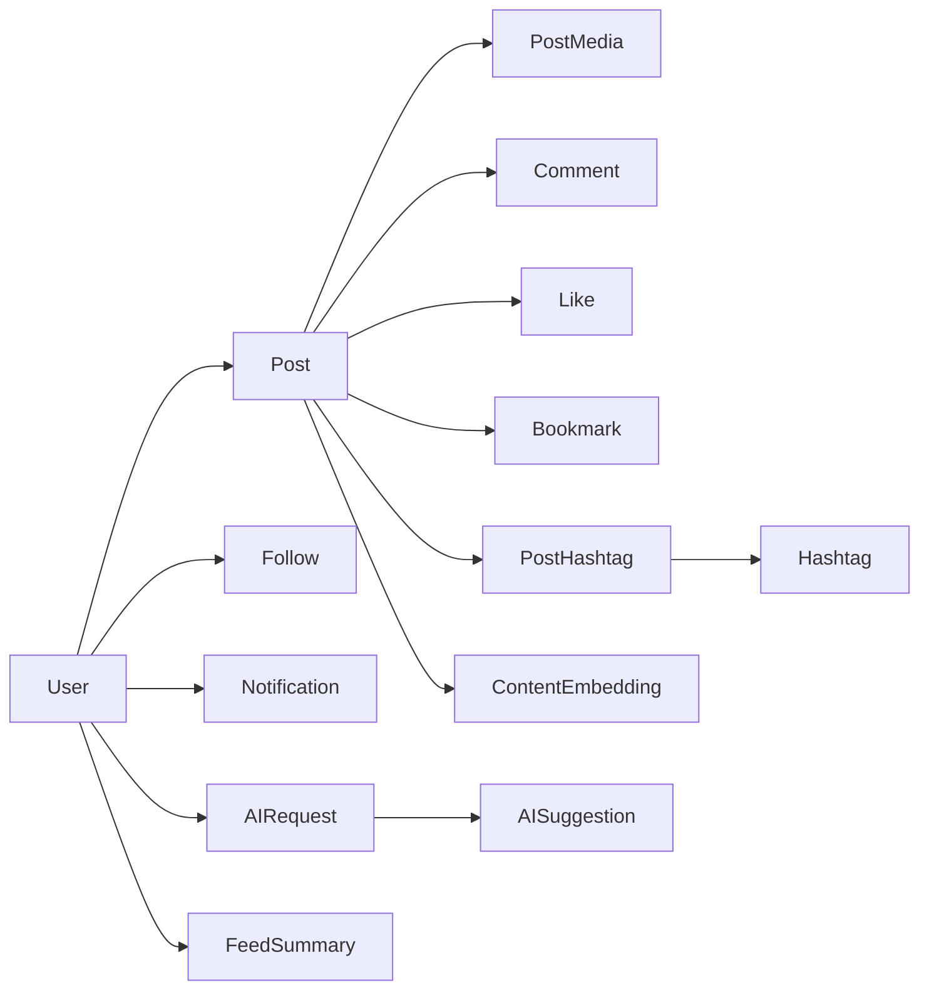
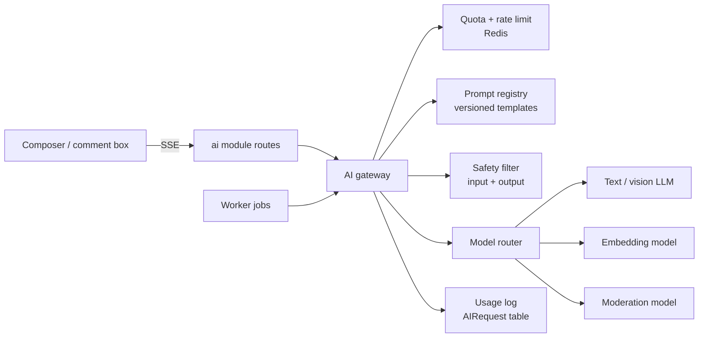

# AI-First Social Platform — Product Requirements Document

Sep 24, 2026 · Live version: https://claude.ai/code/artifact/c1e8c71b-f838-4594-a086-5075da9e317a

## Overview

V1 ships a complete social network where AI helps with every write action. That covers posts, comments, bios and hashtags, plus a daily summary of what the user missed. AI is part of the composer and the feed, not a separate tool page.

**Problem.** Creators spend too long writing posts that get little engagement, and readers can't keep up with busy feeds. Existing platforms either have no AI or keep it in a separate chatbot.

**Target users**

- **Casual creators** post a few times a week and want help getting started ("what do I say about this photo?").
- **Professional creators and small brands** post daily, care about tone and reach, and will pay for more AI.
- **Readers** follow many accounts and want the highlights without scrolling for an hour.

**Goals for V1**

1. A user can go from an idea or photo to a published post in under 60 seconds with AI help.
2. At least 40% of published posts use one or more AI features.
3. AI suggestions return their first token in under 1.5 s at p95 and are fully complete in under 6 s.
4. AI cost stays under $0.05 per daily active user per day.

**Non-goals for V1:** video, direct messages, stories, monetization, native mobile apps, AI image generation, public creator analytics.

**Success metrics**

| Metric | V1 target (90 days after launch) |
| --- | --- |
| AI suggestion acceptance rate (used as-is or edited) | ≥ 35% |
| Posts using AI | ≥ 40% |
| D7 retention | ≥ 25% |
| Feed summary open rate among users who follow 20+ accounts | ≥ 30% |
| AI cost per DAU per day | ≤ $0.05 |
| Rate of AI outputs reported as harmful | < 0.1% |

## Core social features

The eleven core features follow standard social patterns. The table gives the V1 behavior and acceptance criteria for each, and AI hooks are marked where they attach.

| Feature | V1 behavior | Acceptance criteria | AI hook |
| --- | --- | --- | --- |
| Authentication | Email + password, Google OAuth. JWT access token (15 min) plus a rotating refresh token (30 days, httpOnly cookie). Email verification, password reset, logout from all devices. | Refresh token reuse revokes the whole token family. 5 failed logins → 15 min lockout per account + IP. | — |
| Profiles | Username (unique, 3–30 chars), display name, avatar, cover, bio (160 chars), website, location, interests (up to 10 tags), public or private. | Username change allowed once per 30 days. Profile page is server-rendered and indexable when public. | Profile Assistant (bio) |
| Follow / unfollow | One-way follow. Private accounts need approval (follow request). Block and mute. | Blocked users can't see, follow, comment on or mention the blocker. Follower counts update within 5 s. | Feed ranking, Feed Summary |
| Create posts | Text up to 2,200 chars, up to 4 images, hashtags, @mentions. Edit within 15 min, delete any time. Visibility: public, followers-only. | Draft autosaves every 5 s. Published post shows in the author's profile immediately. | Caption, Hashtag, Post Writer, Content Improver |
| Image uploads | Signed direct upload to Cloudinary. JPEG, PNG, WebP, HEIC. Max 10 MB each. Auto crop options 1:1, 4:5, 16:9. Alt text field. | Upload never passes through the API server. EXIF location stripped. | Caption from image, alt text |
| Likes | Toggle like on posts and comments. | Idempotent: double-tap never double-counts. | Engagement signal for ranking |
| Comments | Comments with one level of replies. Up to 1,000 chars. Author can delete any comment on their post. | Sorted by top (likes + recency) or newest. | Comment Assistant |
| Bookmarks | Private save. Optional named collections. | Only the owner can see bookmarks. | Feed Summary can include saved posts |
| Notifications | In-app (realtime) for follows, likes, comments, replies, mentions, follow requests. Email digest for key events. Aggregated ("Ana and 12 others liked your post"). | Delivered in-app within 2 s. Per-type on/off settings. | AI-summarized digest (V2) |
| Search | Users (by username/name), hashtags, posts (full-text). Recent searches. | Results in < 300 ms p95. Private and blocked content never appears. | Semantic search (V2) |
| Personalized feed | Two tabs: **Following** (chronological) and **For You** (ranked). Cursor-paginated. | First page < 400 ms p95. No post shown twice in one session. | Ranking by embeddings, Feed Summary |

## AI features

Every AI feature is a suggestion the user reviews. Nothing is published, commented or saved without an explicit user action. All text features share one tone model and stream output.

**Shared rules for all AI features**

- **Tones:** Professional, Casual, Funny, Gen Z, Motivational. The user's last choice is remembered per feature.
- **Variants:** each request returns 3 options by default. Regenerate is limited per plan.
- **Personal voice (V1.1):** the user can opt in to let AI learn from their last 20 posts so suggestions sound like them.
- **Controls:** accept, edit, regenerate, thumbs up or down. Every suggestion is logged with its prompt version so quality can be measured.
- **Labeling:** posts where most of the text came from AI get an optional "AI-assisted" label. The default is off, and the platform policy decides whether it is required (see Open questions).
- **Safety:** input and output both pass a moderation check. Refusals show a friendly message, never a raw model error.

| # | Feature | Input | Output | Where it appears | Limits (free plan) |
| --- | --- | --- | --- | --- | --- |
| 1 | Caption Generator | Idea text and/or up to 4 uploaded images + tone | 3 captions, each ≤ 2,200 chars | Composer, after image upload | 20 / day |
| 2 | Hashtag Generator | Post text + images | 10–15 hashtags labeled broad or niche, with a user-chosen count | Composer, below the text | 30 / day |
| 3 | Post Writer | Free prompt ("announce my new bakery opening Saturday") + tone + length (short, medium, long) | 3 complete posts including hashtags | Composer "Write with AI" | 10 / day |
| 4 | Content Improver | Selected text or whole draft + action: rewrite, clarify, more engaging, expand, shorten, fix grammar | 1 revised version shown as a diff | Composer toolbar, on text selection | 30 / day |
| 5 | Comment Assistant | The post (text + image description) + the thread + optional user intent ("agree", "ask a question") | 3 short comment suggestions | Comment box, reply box | 30 / day |
| 6 | Profile Assistant | Name, role, interests, 1–3 facts + tone | 3 bios ≤ 160 chars and 1 long description | Profile edit, onboarding | 10 / day |
| 7 | Feed Summary | Top posts from followed accounts since the last visit (max 24 h, max 100 posts) | 5–8 bullet digest, each linking to its source post | Top of the Following tab, optional daily email | 3 / day |

**Feature-specific requirements**

- **Caption from image** uses a vision model. If the image fails moderation, no caption is generated.
- **Hashtags** are checked against a banned-tag list and against real usage in the platform, so the user sees how many posts each tag has.
- **Content Improver** never changes @mentions, links or hashtags unless the action asks for it.
- **Comment Assistant** must not produce generic filler ("Great post!"). Suggestions must reference something specific in the post. It is not offered on posts from accounts the user blocks or that disallow AI replies.
- **Feed Summary** only uses posts the viewer can already see. It is generated once per user per window and cached, not per page view. Each bullet must link to a real post, so the summary never states things with no source.

## Non-functional requirements

V1 is sized for 50,000 registered users and 5,000 DAU. It must scale to 10× that without a redesign.

| Area | Requirement |
| --- | --- |
| Performance | API p95 < 250 ms for non-AI reads. Feed first page < 400 ms. AI first token < 1.5 s, full response < 6 s. |
| Availability | 99.5% monthly for V1. If the AI provider is down, core social features keep working and AI buttons show "temporarily unavailable". |
| Security | Passwords hashed with argon2id. JWT signed with rotating keys. Rate limits per IP and per user on every write endpoint. OWASP Top 10 review before launch. CSP, secure cookies, CSRF protection on cookie-based refresh. |
| Privacy | GDPR-style data export and account deletion (hard delete within 30 days). Private accounts' content is never sent to AI for other users. Users can opt out of their content being used for personalization. |
| AI safety | Moderation on AI input and output. Prompt-injection defenses: user content is always passed as data, never as instructions. No AI output is published automatically. |
| AI cost | Per-user daily quotas, per-feature budgets, a global daily spend cap with alerts at 50%, 80% and 100%. |
| Accessibility | WCAG 2.1 AA. Alt text required prompt on image upload, with an AI suggestion. |
| Observability | Structured logs with request IDs, error tracking, traces across web → API → AI provider. AI dashboard: calls, latency, tokens, cost, acceptance rate per feature. |
| Data retention | AI request logs kept 30 days, then only aggregated metrics. Deleted posts purged from Cloudinary within 7 days. |

## Missing requirements

The brief leaves out 14 requirements. The ones marked V1 are needed for a safe public launch, even though the brief lists some of them as "future".

| Gap | Why it matters | Proposed scope |
| --- | --- | --- |
| Content moderation | Listed as future, but a public platform with image uploads and AI text can't launch without it (legal and app-store risk). | **V1:** automatic text and image moderation on every post, comment and AI output + report button + admin queue. Advanced AI moderation in V2. |
| Report and block | Users need a way to stop harassment. | **V1** |
| Admin panel | Someone has to review reports, ban users and remove content. | **V1** (minimal internal tool) |
| AI usage quotas and plans | AI costs money per call. Without quotas one user or a script can run up the bill. | **V1:** free-tier daily limits. Paid plan in V2. |
| AI feedback and quality tracking | You can't improve prompts you don't measure. | **V1:** thumbs up/down, accept/edit/reject events. |
| AI disclosure policy | Decide whether AI-generated posts are labeled. Regulation (such as the EU AI Act) is moving toward disclosure. | **V1:** decision + optional label. |
| Onboarding | New users have an empty feed and no bio. AI can fix both. | **V1:** pick interests → suggested accounts → AI bio. |
| Drafts | AI-heavy composing takes several attempts. Losing work is frustrating. | **V1** |
| Terms, privacy policy, age gate | Legal requirement. Minimum age 13 (16 in some EU countries). | **V1** |
| Account settings | Change email and password, notification preferences, privacy, delete account, data export. | **V1** |
| Rate limiting and anti-spam | Bots will mass-follow, mass-like and mass-comment. | **V1** |
| Post sharing and links | Link previews (Open Graph) for posts shared outside the app. | **V1:** OG tags. Reposts in V2. |
| Direct messages | Expected by users, but a large feature with its own safety needs. | **V2** |
| Analytics events | Needed to measure the success metrics above. | **V1:** event tracking (PostHog or similar). |

## Database entities

The schema has 26 entities in six groups. All primary keys are UUIDv7, which sort by time and help cursor pagination. Every table has `createdAt`, and user content tables add `updatedAt` and `deletedAt` for soft deletes.

| Group | Entity | Key fields | Notes and indexes |
| --- | --- | --- | --- |
| Identity | **User** | id, email, username, passwordHash, role (user, moderator, admin), status (active, suspended, deleted), emailVerifiedAt | Unique on email and lower(username). |
| Identity | **Profile** | userId, displayName, bio, avatarUrl, coverUrl, website, location, isPrivate, interests[] | 1:1 with User. Kept separate so auth queries stay small. |
| Identity | **RefreshToken** | id, userId, tokenHash, familyId, expiresAt, revokedAt, userAgent, ip | Index on userId. Reuse of a revoked token revokes the whole family. |
| Identity | **OAuthAccount** | userId, provider, providerAccountId | Unique on (provider, providerAccountId). |
| Identity | **UserSettings** | userId, notificationPrefs (JSONB), aiPrefs (JSONB: default tone, personal voice opt-in, allow AI replies), locale | |
| Social graph | **Follow** | followerId, followingId, status (active, pending) | PK (followerId, followingId). Index on (followingId, createdAt). |
| Social graph | **Block** / **Mute** | userId, targetUserId | PK on the pair. |
| Content | **Post** | id, authorId, content, visibility, status (draft, pending_review, published, removed), aiAssisted (bool), likeCount, commentCount, bookmarkCount, editedAt | Index (authorId, createdAt DESC), (status, createdAt DESC). GIN full-text index on content. |
| Content | **PostMedia** | id, postId, cloudinaryPublicId, url, width, height, altText, altTextSource (user, ai), order, moderationStatus | Up to 4 per post. |
| Content | **Hashtag** | id, tag (lowercase), postCount | Unique on tag. |
| Content | **PostHashtag** | postId, hashtagId | PK on the pair. Index (hashtagId, createdAt). |
| Content | **Mention** | postId or commentId, mentionedUserId | Drives notifications. |
| Engagement | **Like** | userId, targetType (post, comment), targetId | PK (userId, targetType, targetId). Counts are denormalized onto Post and Comment. |
| Engagement | **Comment** | id, postId, authorId, parentId (null or one level), content, likeCount, aiAssisted | Index (postId, createdAt). |
| Engagement | **Bookmark** / **BookmarkCollection** | userId, postId, collectionId | PK (userId, postId). |
| Engagement | **Notification** | id, recipientId, type, actorIds[], entityType, entityId, groupKey, readAt | Index (recipientId, createdAt DESC). Grouped by groupKey. |
| AI | **AIRequest** | id, userId, feature, promptVersion, model, inputTokens, outputTokens, costMicros, latencyMs, status, moderationResult | Index (userId, createdAt) for quotas. Detailed rows kept 30 days. |
| AI | **AISuggestion** | id, aiRequestId, variantIndex, content, outcome (shown, accepted, edited, rejected), feedback (up, down), resultingEntityId | How acceptance rate is measured. |
| AI | **AIUsageQuota** | userId, feature, date, count | Or kept in Redis, with a daily copy to Postgres. |
| AI | **ContentEmbedding** | entityType (post, user_interest), entityId, embedding vector(1536), model | pgvector HNSW index. Used for For You ranking and later semantic search. |
| AI | **FeedSummary** | id, userId, windowStart, windowEnd, content (JSONB bullets with postIds), aiRequestId | One per user per window. Cached. |
| AI | **PromptTemplate** | id, feature, version, template, model, params, isActive | Prompts are versioned data, not strings hidden in code. |
| Trust and safety | **Report** | id, reporterId, targetType, targetId, reason, status, resolvedBy | Admin queue. |
| Trust and safety | **ModerationEvent** | id, entityType, entityId, source (ai, user_report, admin), labels (JSONB), action | Audit trail. |

**Designed for later:** `Conversation` and `Message` (DMs), `MediaAsset` with a type column for video, `TrendSnapshot` (trend detection), `CreatorDailyStats` (analytics), `Subscription` and `Plan` (paid AI tiers). None of these require changes to the V1 tables.

## API modules

The Express API is split into 13 modules under `/api/v1`, one per domain. Each module owns its routes, validation, service logic and database access, and modules call each other only through services.

| Module | Key endpoints | Notes |
| --- | --- | --- |
| **auth** | POST /auth/register, /auth/login, /auth/refresh, /auth/logout, /auth/logout-all, /auth/verify-email, /auth/forgot-password, /auth/reset-password, GET /auth/oauth/google | Issues JWT access token + refresh cookie. Strict rate limits. |
| **users** | GET /users/me, PATCH /users/me, GET /users/:username, GET /users/:username/posts, DELETE /users/me, POST /users/me/export | Profile, settings, account deletion. |
| **social** | POST/DELETE /users/:id/follow, GET /users/:id/followers, /following, GET/POST /follow-requests/:id/(approve, reject), POST/DELETE /users/:id/block, /mute | Emits events for notifications and feed. |
| **posts** | POST /posts, GET /posts/:id, PATCH /posts/:id, DELETE /posts/:id, GET/POST /drafts | Publishing triggers moderation, embeddings and fan-out jobs. |
| **media** | POST /media/upload-signature, POST /media/confirm | Returns a Cloudinary signed upload. Client uploads directly. The confirm step triggers image moderation. |
| **engagement** | POST/DELETE /posts/:id/like, GET/POST /posts/:id/comments, DELETE /comments/:id, POST/DELETE /comments/:id/like, POST/DELETE /posts/:id/bookmark, GET /bookmarks | Idempotent toggles. |
| **feed** | GET /feed/following?cursor=, GET /feed/for-you?cursor= | Cursor pagination only. |
| **notifications** | GET /notifications?cursor=, POST /notifications/read, GET /notifications/unread-count, WebSocket channel | Realtime through Socket.IO. |
| **search** | GET /search?q=&type=(users, posts, hashtags), GET /hashtags/:tag, GET /hashtags/trending | Postgres full-text in V1. |
| **ai** | POST /ai/caption, /ai/hashtags, /ai/write-post, /ai/improve, /ai/comment-suggestions, /ai/bio, GET /ai/feed-summary, POST /ai/suggestions/:id/feedback, GET /ai/usage | Server-sent events (SSE) streaming. Quota checked before every call. |
| **moderation** | POST /reports, internal hooks for automatic checks | Used by posts, comments, media and AI. |
| **admin** | GET /admin/reports, POST /admin/reports/:id/resolve, POST /admin/users/:id/suspend, DELETE /admin/posts/:id, GET /admin/ai/metrics | Role-protected. |
| **health** | GET /health, GET /ready | For load balancers and deploys. |

**Conventions:** JSON errors in one shape (`{ error: { code, message, details } }`), Zod validation on every input, idempotency keys on POST /posts, `Authorization: Bearer <jwt>` for API calls.

## AI service architecture

All AI calls go through one internal AI gateway inside the Express API. Feature code never calls a model provider directly. Interactive features stream synchronously through the gateway, and background features (Feed Summary, embeddings, moderation) run as queue jobs in the worker.

A request passes through the gateway in this order: quota check, input moderation, prompt build, model call, output moderation, output validation, logging.

**Gateway layers**

1. **Feature handlers** (one per feature: caption, hashtags, writePost, improve, commentSuggest, bio, feedSummary). Each builds a typed context and declares its output schema, for example `{ captions: string[3] }`.
2. **Prompt registry.** Templates are stored in `PromptTemplate` with a version. A new prompt can be tested on a percentage of traffic and compared by acceptance rate.
3. **Context builder.** Collects what the model needs: image descriptions, the post and thread, the user's tone preference, their recent posts (only with opt-in). User content is wrapped as quoted data to reduce prompt injection.
4. **Model router.** Maps each feature to a model tier. Fast and cheap models for hashtags, comment suggestions and short rewrites. A stronger model for Post Writer and Feed Summary. A vision model for image captions. The provider sits behind an interface so it can be switched or given a fallback.
5. **Safety layer.** Moderation on user input before the call and on output after it. Blocked outputs are replaced with a safe message and logged.
6. **Output validation.** Structured JSON output checked against the schema. One automatic retry on invalid output, then a clean error.
7. **Quotas and cost.** Redis counters per user, feature and day. Token and cost logging on every call. A global spend circuit breaker.
8. **Caching.** Identical requests (same input hash, tone and prompt version) served from Redis for 24 h. Image descriptions are generated once per image and reused by captions, hashtags, alt text and comment suggestions.

**Background AI jobs (BullMQ worker)**

| Job | Trigger | Output |
| --- | --- | --- |
| moderatePost | Post or comment published, media confirmed | Status approved, pending_review or removed + ModerationEvent |
| describeImage | Media confirmed | Cached image description used by other features |
| embedPost | Post approved | ContentEmbedding row for For You ranking |
| embedUserInterests | Nightly or after 10 new interactions | User interest vector |
| buildFeedSummary | First visit of the day, or scheduled for email users | FeedSummary row |

**For You ranking (V1).** Candidates come from followed accounts, posts similar to the user's interest vector (pgvector), and recent popular posts. They are scored by a weighted formula of similarity, engagement, recency and author affinity. Weights live in config, and a learned model replaces the formula in V2.

**Designed for later.** Image generation, video captions, trend detection and creator analytics plug in as new feature handlers and new job types. The gateway, quotas, logging and safety layers stay the same.

## V1 MVP scope

V1 includes all 11 core social features, all 7 AI features and the 5 safety and operations items that make a public launch possible. The estimate is 16–18 weeks for 2–3 engineers.

**Core social (all V1)**

- [ ] Auth: email + password, Google OAuth, JWT with refresh rotation, email verification, password reset
- [ ] Profiles with avatar and cover through Cloudinary, public and private accounts
- [ ] Follow, unfollow, follow requests, block, mute
- [ ] Posts: text + up to 4 images, hashtags, mentions, drafts, edit within 15 min, delete
- [ ] Likes, comments with one level of replies, bookmarks (no collections yet)
- [ ] In-app realtime notifications + weekly email digest
- [ ] Search for users, hashtags and posts (Postgres full-text)
- [ ] Following feed (chronological) + For You feed (embedding-based ranking)
- [ ] Onboarding: interests → suggested accounts → AI bio

**AI (all 7 in V1, with a narrower first version of some)**

- [ ] Caption Generator: from text and from images, 5 tones
- [ ] Hashtag Generator: broad and niche labels
- [ ] Post Writer: 3 lengths, 5 tones
- [ ] Content Improver: rewrite, clarify, more engaging, expand, shorten, fix grammar
- [ ] Comment Assistant: suggestions for comments and replies
- [ ] Profile Assistant: bios and long description
- [ ] Feed Summary: in-app, once per day (the daily email version moves to V1.1)
- [ ] AI alt text for uploaded images

**Safety and operations (required for launch)**

- [ ] Automatic text and image moderation on posts, comments and AI output
- [ ] Report button + minimal admin panel
- [ ] Free-tier AI quotas, cost logging, global spend cap
- [ ] AI feedback (thumbs, accept, edit, reject) and an acceptance-rate dashboard
- [ ] Terms, privacy policy, age gate, account deletion and data export

All 7 AI features are in V1 because the product is defined as AI-first. The trade-off is that each ships in its simplest useful form: no personal voice, no learned ranking, no paid tier.

## V2 and later

V2 moves the platform from AI-assisted writing to AI-driven growth. It adds the five "future" AI features, a paid plan and the social features that need more safety work.

| Feature | Release | Why it waits |
| --- | --- | --- |
| Personal voice (AI learns from the user's posts) | V1.1 | Needs opt-in consent flow and enough post history. |
| Feed Summary daily email | V1.1 | Email deliverability setup, and in-app usage data first. |
| Bookmark collections | V1.1 | Low effort, low priority. |
| Paid AI plan (higher quotas, stronger models) | V2 | Needs V1 cost and usage data to set prices. |
| AI image generation | V2 | High cost per call, extra moderation for generated images, copyright questions. |
| Advanced AI moderation (context-aware, appeals) | V2 | V1 automatic checks + human review are enough at launch size. |
| AI creator analytics ("why did this post do well") | V2 | Needs weeks of engagement data per creator. |
| AI trend detection | V2 | Needs enough post volume to find real trends. |
| AI video captions | V2 | Video upload and transcoding must come first. |
| Video posts | V2 | Storage, transcoding and moderation cost. |
| Direct messages | V2 | Separate safety model (spam, harassment, encryption decision). |
| Reposts and quote posts | V2 | Changes feed and notification logic. |
| Semantic search | V2 | Embeddings exist in V1, so this becomes a small addition. |
| Learned feed ranking model | V2 | Needs interaction data to train on. |
| AI notification digest | V2 | Builds on Feed Summary. |
| Native mobile apps | V2+ | The API-first design already supports them. |

## Open questions

- [ ] Should posts written mostly by AI carry a visible "AI-assisted" label, and is it optional or required?
- [ ] Which AI model provider for V1, and is a second provider needed as fallback at launch?
- [ ] Are the free-tier daily quotas in the AI features table the right starting point?
- [ ] Can users turn off AI comment suggestions on their own posts?
- [ ] Launch regions, which affect the age gate and data residency (EU users)?
- [ ] Is Google the only OAuth provider for V1, or also Apple?
